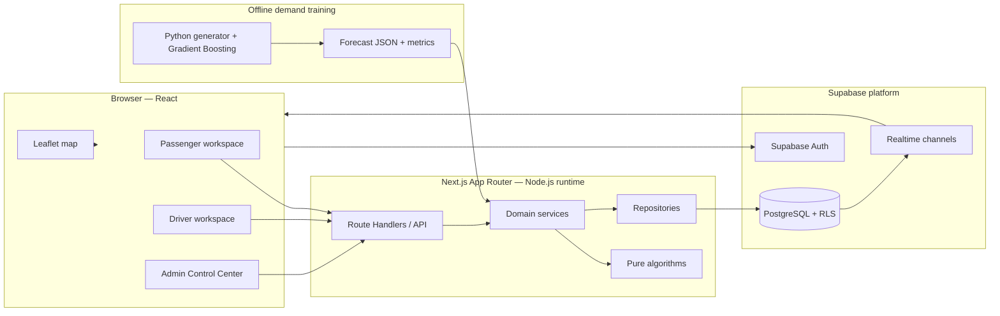

# System Architecture

## 1. Architectural approach

Use a modular monolith. A 24-hour prototype does not justify microservices, message brokers or a separately deployed Python inference API. A single Next.js application owns the UI and Node.js API endpoints; Supabase provides PostgreSQL, Auth and optional Realtime. The demand model is trained offline by a reproducible Python script and exports a forecast artifact consumed by the Node application.



## 2. Selected stack and runtime

### Frontend
- React + Next.js App Router + TypeScript.
- Server Components for page shells/data loading where useful.
- Client Components for maps, charts, interactive booking forms, driver requests and subscriptions.
- Leaflet must load only in browser components. Provide a fixed-height loading placeholder and an error fallback.

### Backend
- Next.js Route Handlers are the Node.js API surface.
- Set `export const runtime = 'nodejs'` on routes using server-only Node-compatible dependencies, database access or artifact reading.
- Validate every request using Zod.
- Resolve session and role on the server before business operations.
- Keep handlers thin: authenticate/validate → call service → map domain error → return typed response.

### Data and identity
- Supabase PostgreSQL stores profiles, drivers, rides, events, zones, forecast outputs, pools and simulation results.
- Supabase Auth handles credentials and session.
- Use supported `@supabase/ssr` patterns for Next.js cookie-based auth.
- Supabase Realtime may update ride status and driver requests. If private-channel authorization or time becomes a blocker, use short polling with last-updated/stale states; don't call polling realtime.

### Mapping
- Leaflet / React-Leaflet renders OSM tiles and app-owned markers/overlays.
- Required attribution remains visible: `© OpenStreetMap contributors`.
- Use seeded coordinates and map-click selection for MVP; don't assume OSM tile servers are an unlimited production tile API.
- Distance uses Haversine. ETA is approximate unless a road-routing service is explicitly configured. A straight line on a map is not a road route.

## 3. Suggested repository structure

```text
fairride-ai/
├── app/
│   ├── (public)/                 # landing, login, signup
│   ├── passenger/                # passenger pages
│   ├── driver/                   # driver pages
│   ├── admin/                    # admin operations pages
│   ├── api/
│   │   ├── rides/
│   │   ├── drivers/
│   │   ├── dispatch/
│   │   ├── zones/
│   │   ├── pooling/
│   │   └── simulation/
│   ├── layout.tsx
│   └── globals.css
├── components/
│   ├── shell/ maps/ passenger/ driver/ admin/ charts/ ui/
├── lib/
│   ├── auth/ db/ repositories/ services/ algorithms/ schemas/ realtime/ utils/
├── supabase/migrations/
├── scripts/
│   ├── generate-demand-history.py
│   ├── train-demand-model.py
│   ├── seed-demo-data.ts
│   └── verify-forecast-artifact.ts
├── data/generated/               # versioned demo forecast artifact only
├── tests/unit/ integration/ e2e/
├── docs/ prompts/
├── GEMINI.md
├── AGENTS.md
└── README.md
```

The coding agent may adapt naming to current Next.js conventions but must preserve module boundaries.

## 4. Module responsibilities

| Module | Responsibility | Must not do |
|---|---|---|
| Auth/role guard | Verify current user and role | Trust role in request body |
| Ride service | Create/cancel ride, history | Contain UI presentation logic |
| Dispatch service | Discover candidates, assign, retry, handle exceptions | Randomly choose a driver |
| Matching algorithm | Pure feature normalization/scoring | Query database directly |
| Location service | Validate coordinates, Haversine, ETA assumptions | Claim road distance without routing provider |
| Demand service | Read trained forecast artifact and zone supply | Label synthetic forecast as real-city prediction |
| Zone intelligence | Pressure, surge rule and reposition recommendation | Teleport driver without acceptance/simulation |
| Pooling service | Compatibility and stop-order optimization | Ignore detour/time constraints |
| Simulation service | Deterministic baseline/FairRide comparison | Mutate live ride records or fake admin metrics |
| Repository layer | Persist/retrieve entities | Bypass calling service authorization assumptions |
| UI components | Render state and submit actions | Reimplement canonical business rules separately |

## 5. Booking and assignment data flow

1. Passenger submits pickup/destination and optional vehicle category.
2. Route handler authenticates passenger and validates body.
3. Ride service validates coordinates, duplicate request and active-ride constraints.
4. Driver repository reads fresh available candidates.
5. Dispatch service calculates distance/ETA, applies max-ETA guardrail, ranks candidates and creates assignment.
6. Transaction/RPC inserts ride, assigns candidate, updates driver state and writes ride event.
7. Realtime/polling informs driver and passenger.
8. Driver accepts/rejects; route verifies that driver is the assigned recipient.
9. Rejection starts bounded retry excluding previous drivers.
10. Every state transition appends a `ride_events` row.

## 6. Consistency rules

- A driver has at most one active ride.
- A ride has at most one current assigned driver.
- Assignment changes ride and driver state consistently.
- Acceptance cannot succeed after reassignment/expiry.
- Two concurrent accept requests cannot both win.
- Event history is append-only for normal app roles.
- Use idempotency keys for ride creation and response actions where feasible.
- Critical cross-row invariants belong in a transaction, stored function/RPC or locking strategy—not only in the browser.

## 7. Real-time update strategy

Preferred: private, authorized Supabase Realtime topics for a ride and driver request queue. Subscribe only to fields the current user needs. Protect private channels with authorization policies.

Fallback: poll only relevant endpoints every 3–5 seconds while a request/ride is active; pause when the tab is hidden and show `Last updated`/stale indicators. Don't poll every admin table continuously.

## 8. Deployment topology

- Next.js app deployed to a Node-compatible host (Vercel target).
- Supabase project for Postgres/Auth/Realtime.
- Python model training runs locally or in a reproducible CI step.
- Version only synthetic forecast artifacts/metrics required for demo; never secrets or personal data.
- Regenerated model records training seed, data version, feature set, algorithm and evaluation metrics.
