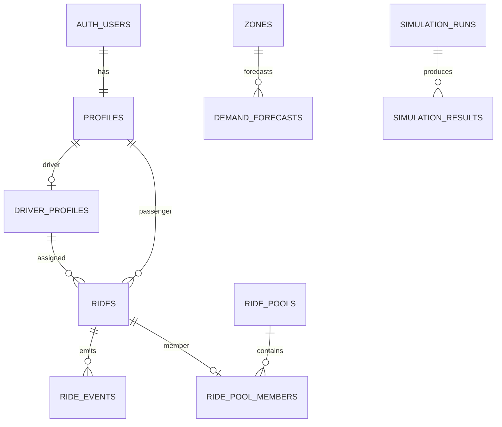

# Database Model, PostgreSQL Schema and RLS Plan

## 1. Data model overview

Use PostgreSQL via Supabase. The domain has strict relationships and lifecycle transitions, so a relational model is the right MVP choice.

## 2. Core tables

### `profiles`
- `id uuid primary key references auth.users(id) on delete cascade`
- `display_name text not null`
- `role text not null check (role in ('passenger','driver','admin'))`
- `created_at timestamptz not null default now()`
- `updated_at timestamptz not null default now()`

Role is provisioned by a trusted server flow/admin operation. Users cannot promote themselves.

### `driver_profiles`
- `user_id uuid primary key references profiles(id) on delete cascade`
- `availability text not null check (availability in ('offline','available','busy'))`
- `vehicle_label text not null`
- `vehicle_type text not null default 'standard'`
- `vehicle_registration_label text` (demo-safe display only; avoid real registration unless needed)
- `current_lat double precision`, `current_lng double precision`
- `location_source text not null default 'simulated' check (location_source in ('simulated','browser_geolocation'))`
- `location_recorded_at timestamptz`
- `online_since timestamptz`, `idle_since timestamptz`
- `accepted_count integer not null default 0 check (accepted_count >= 0)`
- `offered_count integer not null default 0 check (offered_count >= 0)`
- `completed_rides integer not null default 0 check (completed_rides >= 0)`
- `active_minutes_today integer not null default 0 check (active_minutes_today >= 0)`
- `created_at`, `updated_at`

Acceptance reliability should be derived with smoothing from accepted/offered counts, not accepted from client. Current coordinates are adequate for the demo; a production version should separate location history and retention controls.

### `zones`
- `id uuid primary key default gen_random_uuid()`
- `slug text unique not null`, `name text not null`
- `center_lat double precision not null`, `center_lng double precision not null`
- `radius_km numeric(7,2) not null default 2.0`
- `is_active boolean not null default true`, `created_at timestamptz not null default now()`

### `rides`
- `id uuid primary key default gen_random_uuid()`
- `passenger_id uuid not null references profiles(id)`
- `assigned_driver_id uuid references driver_profiles(user_id)`
- `pickup_label text not null`, `pickup_lat double precision not null`, `pickup_lng double precision not null`
- `destination_label text not null`, `destination_lat double precision not null`, `destination_lng double precision not null`
- `status text not null check (status in ('requested','accepted','arriving','ongoing','completed','cancelled','reassigning','unassigned','expired'))`
- `distance_km numeric(8,2) not null`
- `pickup_eta_minutes numeric(7,2)`, `trip_eta_minutes numeric(7,2)`
- `base_fare numeric(10,2) not null`, `distance_fare numeric(10,2) not null`
- `surge_multiplier numeric(4,2) not null default 1.00`
- `fare_estimate numeric(10,2) not null`, `fare_final numeric(10,2)`
- `requested_at timestamptz not null default now()`, `accepted_at timestamptz`, `arriving_at timestamptz`, `started_at timestamptz`, `completed_at timestamptz`
- `request_expires_at timestamptz`
- `match_metadata jsonb not null default '{}'::jsonb`
- `idempotency_key text`, `created_at`, `updated_at`

Use a unique partial index on `(passenger_id, idempotency_key)` where key is not null. Add coordinate range checks and non-negative fare/distance checks.

### `ride_events`
- `id uuid primary key default gen_random_uuid()`
- `ride_id uuid not null references rides(id) on delete cascade`
- `event_type text not null`, `from_status text`, `to_status text`
- `actor_id uuid references profiles(id)`, `actor_role text`
- `description text not null`, `payload jsonb not null default '{}'::jsonb`
- `created_at timestamptz not null default now()`

Append-only for normal app roles. This is the audit timeline for assignment, response, state changes, cancellation, delay and reassignment.

### `demand_forecasts`
- `id uuid primary key default gen_random_uuid()`
- `zone_id uuid not null references zones(id)`
- `forecast_for timestamptz not null`
- `predicted_requests numeric(10,2) not null check (predicted_requests >= 0)`
- `actual_requests integer check (actual_requests >= 0)`
- `model_name text not null`, `model_version text not null`
- `source_label text not null default 'SIMULATED'`
- `mae numeric(10,4)`, `rmse numeric(10,4)`
- `created_at timestamptz not null default now()`

Unique constraint: `(zone_id, forecast_for, model_version)`.

### `ride_pools`
- `id uuid primary key default gen_random_uuid()`
- `driver_id uuid references driver_profiles(user_id)`
- `status text not null check (status in ('proposed','confirmed','in_progress','completed','cancelled'))`
- `route_sequence jsonb not null`
- `total_distance_km numeric(8,2) not null`, `total_eta_minutes numeric(8,2) not null`
- `shared_fare numeric(10,2) not null`
- `created_at`, `updated_at`

### `ride_pool_members`
- `pool_id uuid not null references ride_pools(id) on delete cascade`
- `ride_id uuid not null references rides(id) on delete cascade`
- `passenger_index integer not null`
- `separate_fare numeric(10,2) not null`, `pooled_fare numeric(10,2) not null`
- `added_time_minutes numeric(8,2) not null`
- primary key `(pool_id, ride_id)`
- Ensure a ride cannot be in two simultaneously active pools (partial unique index or transaction-backed invariant).

### `simulation_runs` and `simulation_results`
`simulation_runs`: `id`, `scenario`, `request_count`, `seed`, `algorithm_version`, `parameters jsonb`, `created_by`, `created_at`.  
`simulation_results`: `id`, `run_id`, `algorithm_name`, `metrics jsonb`, `per_driver_metrics jsonb`, `created_at`.

Optional `driver_location_history` or `zone_supply_snapshots` can be added if time allows; don't build a high-volume telemetry platform for MVP.

## 3. Useful indexes

- `rides(passenger_id, requested_at desc)`
- `rides(assigned_driver_id, requested_at desc)`
- `rides(status, requested_at)`
- `ride_events(ride_id, created_at)`
- `driver_profiles(availability, location_recorded_at)`
- `demand_forecasts(zone_id, forecast_for desc)`
- `zones(slug)`

## 4. Integrity constraints

- A `busy` driver must have an active ride; an available driver must not.
- A driver cannot be assigned two non-terminal rides.
- A ride cannot have two active assignments.
- Driver can accept only their request and only while it is `requested`.
- State update and corresponding event insert happen in the same transaction.
- Fare components are non-negative; surge multiplier stays within configured bound.
- Validate coordinate ranges in API schema and DB constraints.

Where a simple check constraint cannot enforce a cross-row rule, use a transaction, database function/RPC or lock. Browser checks are UX only.

## 5. RLS and authorization plan

Enable RLS on every exposed table. RLS is defence in depth; server role checks are still required.

| Table | Passenger | Driver | Admin |
|---|---|---|---|
| profiles | Own safe fields | Own safe fields | Read all |
| driver_profiles | Safe public availability/location projection | Own safe fields | Read all |
| rides | Own passenger rides | Assigned rides | Read all |
| ride_events | Events for own rides | Events for assigned rides | Read all |
| zones | Read active zones | Read active zones | Manage |
| demand_forecasts | Only pricing summary if exposed | Limited zone hints if needed | Read all |
| ride_pools / members | Own membership | Assigned pool | Read/manage all |
| simulation tables | No direct write | No direct write | Read/create admin runs |

Implementation rules:

1. A general profile update must never modify `role`.
2. Passenger/driver clients should not have broad writes to `rides`; state mutations go through server routes or narrowly scoped RPC.
3. Nearby-driver discovery uses a safe projection/view/API; don't expose email, phone or unrelated fields.
4. A service-role key, if required, is server-only. Authenticate, check role and ownership in route/service before using it. Never put it in `NEXT_PUBLIC_`.
5. Test RLS allow and deny cases through direct data access, not only the UI.
6. Supabase `service_role` bypasses RLS; every elevated server route must implement its own authorization and validation.
7. Protect private Realtime channels. If this cannot be verified, use authorized polling.

## 6. Migration requirements

- Schema changes live in timestamped SQL files under `supabase/migrations/`.
- Include constraints, indexes, RLS enablement and policies in migrations.
- Generate TypeScript DB types if practical.
- Seed demo accounts/data reproducibly; never commit passwords.
- Test migrations on a clean database.

## 7. Forecast artifact storage

Preferred: training script exports `data/generated/zone-demand-forecast.json`; seed/import script writes rows to `demand_forecasts`; Admin pages read model version, source label and forecast time. If DB seeding fails, the server may read the static artifact, but UI still displays its synthetic source/model metadata.
