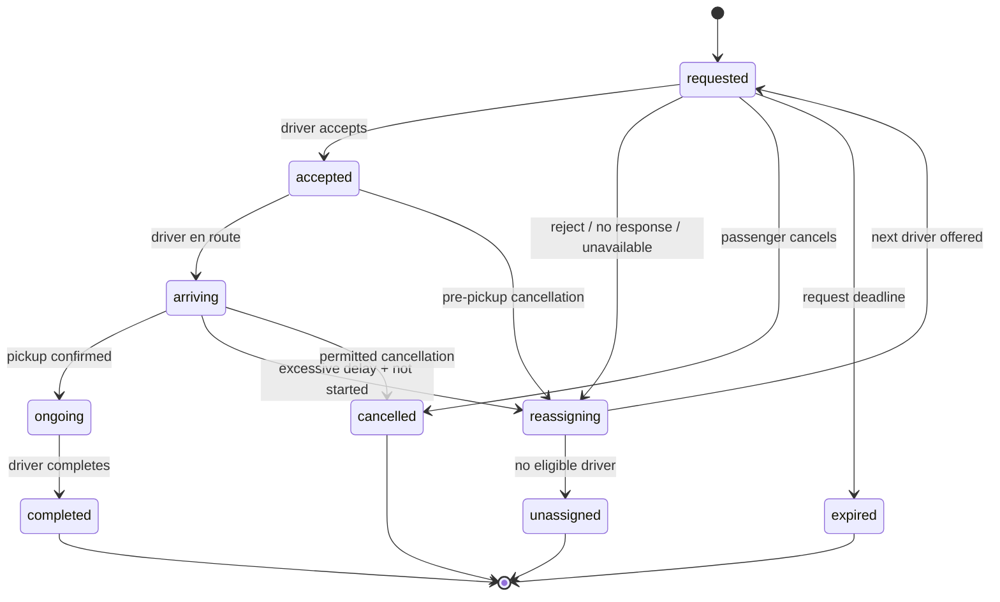

# API Contracts and Ride State Machine

## 1. API conventions

- Base path: `/api`.
- JSON request/response unless noted.
- Every write authenticates and authorizes the current session on the server.
- Validate request bodies with Zod.
- Use a consistent error envelope and accurate HTTP codes: 400 validation, 401 unauthenticated, 403 unauthorized, 404 missing, 409 conflict/state, 422 domain rule, 429 rate limit, 500 unexpected.
- Never expose stack traces, SQL or secrets to the client.

### Success envelope
```json
{ "data": {}, "meta": { "requestId": "...", "generatedAt": "ISO-8601" } }
```

### Error envelope
```json
{
  "error": {
    "code": "RIDE_STATE_CONFLICT",
    "message": "This request is no longer available.",
    "fieldErrors": {}
  },
  "meta": { "requestId": "..." }
}
```

## 2. Endpoint contract

| Method + path | Role | Purpose |
|---|---|---|
| `GET /api/me` | Authenticated | Current profile and role |
| `GET /api/drivers/nearby?lat=&lng=` | Passenger/Admin | Safe available-driver projection with distance/ETA |
| `PATCH /api/driver/availability` | Driver | Own online/offline status |
| `PATCH /api/driver/location` | Driver | Own coordinate/source timestamp |
| `POST /api/rides` | Passenger | Create ride and dispatch |
| `GET /api/rides/:id` | Owner/assigned driver/Admin | Permitted ride view |
| `GET /api/rides` | Passenger/Driver/Admin | Role-scoped history/current rides |
| `POST /api/rides/:id/respond` | Assigned Driver | Accept/reject |
| `POST /api/rides/:id/status` | Assigned Driver | Arriving/Ongoing/Completed |
| `POST /api/rides/:id/cancel` | Passenger/Driver/Admin | Cancel if allowed |
| `POST /api/dispatch/:id/reassign` | System/Admin | Reassign after exception |
| `POST /api/dispatch/expire-pending` | System/Admin | Server-check expired requests (MVP/demo) |
| `GET /api/admin/overview` | Admin | KPIs and operational summary |
| `GET /api/admin/fleet` | Admin | Fleet status/location projection |
| `GET /api/zones/intelligence` | Admin | Forecast, supply, pressure, surge, reposition |
| `GET /api/pooling/candidates` | Admin/System | Compatible requests/proposals |
| `POST /api/pooling/proposals/:id/confirm` | Authorized participants/Admin | Confirm accepted pool proposal |
| `POST /api/simulation/runs` | Admin | Run and persist deterministic simulation |
| `GET /api/simulation/runs/:id` | Admin | Stored simulation output |

## 3. Representative payloads

### Create ride
```json
{
  "pickup": { "label": "Central Market", "lat": 12.3456, "lng": 76.1234, "source": "seed" },
  "destination": { "label": "Rail Hub", "lat": 12.3567, "lng": 76.1345, "source": "seed" },
  "vehicleType": "standard",
  "idempotencyKey": "client-generated-uuid"
}
```
Response contains ride ID, state, distance, pickup ETA, itemized fare, assigned-driver projection (if assigned), explanation and response deadline.

### Driver response
```json
{ "decision": "accept" }
```
or
```json
{ "decision": "reject", "reasonCode": "UNAVAILABLE" }
```

### Driver state update
```json
{ "nextStatus": "arriving" }
```
Only the next valid state is accepted.

### Driver location
```json
{
  "lat": 12.3456,
  "lng": 76.1234,
  "source": "browser_geolocation",
  "recordedAt": "2026-11-13T10:30:00+05:30"
}
```

### Run simulation
```json
{
  "scenario": "balanced",
  "requestCount": 100,
  "seed": 4172,
  "maxPickupEtaMinutes": 12,
  "algorithmVersion": "fairride-v1"
}
```
Server clamps request count and validates parameters.

## 4. Domain types

```ts
export type UserRole = 'passenger' | 'driver' | 'admin';
export type DriverAvailability = 'offline' | 'available' | 'busy';
export type RideStatus =
  | 'requested' | 'accepted' | 'arriving' | 'ongoing' | 'completed'
  | 'cancelled' | 'reassigning' | 'unassigned' | 'expired';
export type LocationSource = 'simulated' | 'browser_geolocation' | 'seed';
export type DemandSource = 'synthetic_gradient_boosting' | 'synthetic_baseline' | 'fallback_estimate';
```

## 5. Ride state machine



### Allowed transitions

| Current | Next | Actor | Rule |
|---|---|---|---|
| requested | accepted | Assigned driver | Before expiry; atomic claim |
| requested | reassigning | Dispatch service | Rejection/no response/unavailable |
| requested | cancelled | Passenger/Admin | Before acceptance, policy permitting |
| requested | expired | Dispatch service | Deadline/no candidate as configured |
| reassigning | requested | Dispatch service | New driver offered; increment attempts |
| reassigning | unassigned | Dispatch service | No candidate or attempts exhausted |
| accepted | arriving | Assigned driver | Driver en route |
| accepted | reassigning | Dispatch/driver cancellation | Before trip starts only |
| arriving | ongoing | Assigned driver | Pickup confirmed |
| arriving | reassigning | Dispatch service | Delay threshold exceeded before start |
| arriving | cancelled | Permitted actor | Reason recorded |
| ongoing | completed | Assigned driver | Completion recorded |

No terminal state can reopen. `completed`, `cancelled`, `expired` and `unassigned` are terminal in MVP.

## 6. Idempotency and concurrency

- Ride creation idempotency key maps duplicate submissions to original request.
- Acceptance uses a DB condition/transaction/row lock; only one driver can win.
- Reassignment tracks tried drivers and attempt count. Don't re-offer same driver within one dispatch cycle.
- Status update checks expected current state; duplicate completion cannot double-count metrics.
- State update and event insertion happen atomically.

## 7. Realtime topics

Preferred private topics:
- `ride:{rideId}` — passenger, currently assigned driver and authorized admin.
- `driver:{driverId}:requests` — that driver and authorized admin.
- `admin:dispatch` — admins only.

Broadcast only required fields. Never broadcast email, phone, tokens or full user records. Enforce channel authorization. Use polling fallback if private channel rules cannot be verified.

## 8. Error codes

`AUTH_REQUIRED`, `ROLE_FORBIDDEN`, `INVALID_COORDINATES`, `DRIVER_LOCATION_STALE`, `NO_ELIGIBLE_DRIVERS`, `RIDE_ALREADY_ASSIGNED`, `RIDE_REQUEST_EXPIRED`, `RIDE_STATE_CONFLICT`, `DRIVER_NOT_ASSIGNED`, `DRIVER_ALREADY_BUSY`, `REASSIGNMENT_LIMIT_REACHED`, `POOL_INCOMPATIBLE`, `SIMULATION_LIMIT_EXCEEDED`, `FORECAST_ARTIFACT_MISSING`.

Each code has a human-readable message.
